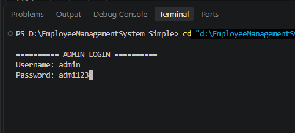
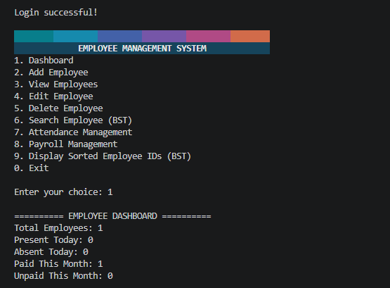
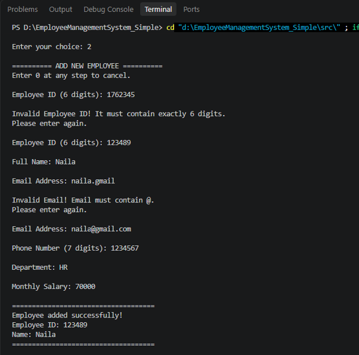
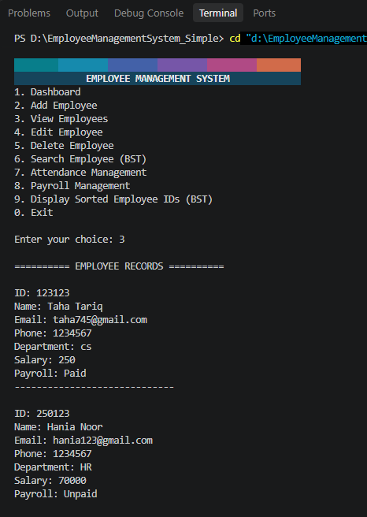
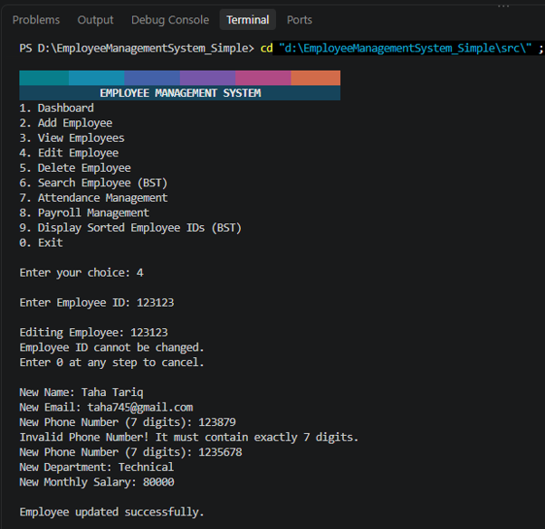
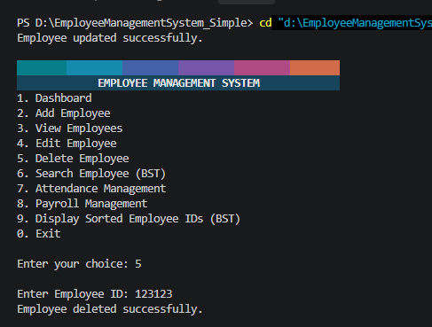
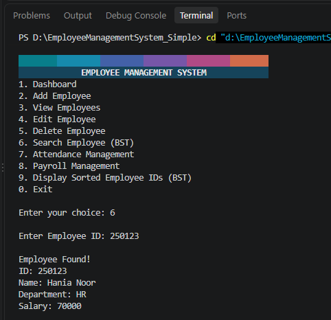
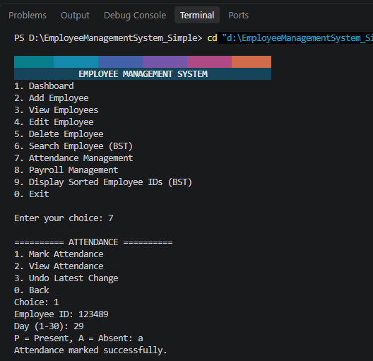
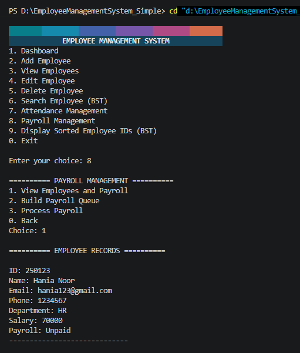
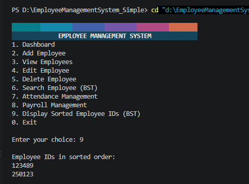

<div align="center">

# 🌈 EMPLOYEE MANAGEMENT SYSTEM

### C++ | Data Structures & Algorithms | CS214

<p>
  
  
  
  
</p>

**A simple employee record, attendance, and payroll management system built using C++ and fundamental data structures.**

</div>

---

## 📌 About the Project

The **Employee Management System** is a menu-driven, console-based C++ academic project developed for **CS214 – Data Structures & Algorithms** at Air University.

The application provides an administrator with a central place to manage employee records, mark and review attendance, check monthly payroll status, and search employee IDs.

The main purpose of this project is to demonstrate the practical implementation of five fundamental data structures: Arrays, Linked Lists, Stacks, Queues, and Binary Search Trees.

## ✨ Features

| Feature | Description |
|---|---|
| 🔐 Admin Login | Provides access through administrator credentials. |
| 📊 Dashboard | Displays employee totals, present/absent counts, and paid/unpaid salary status. |
| ➕ Add Employee | Adds new employee records with input validation. |
| 👥 View Employees | Displays all stored employee records. |
| ✏️ Edit Employee | Updates employee information while keeping the employee ID fixed. |
| 🗑️ Delete Employee | Removes an employee record. |
| 🔎 Search Employee | Searches for employees using a Binary Search Tree. |
| 📅 Attendance Management | Allows attendance marking and viewing. |
| ↩️ Undo Attendance | Reverses the latest attendance correction during the current session. |
| 💰 Payroll Management | Processes unpaid employees through a FIFO queue. |
| 🌳 Sorted Employee IDs | Displays employee IDs in sorted order using a BST. |
| 💾 File Handling | Saves employee records locally in a text file. |

---

# 🖥️ Application Screenshots

The following screenshots demonstrate the main features and working of the Employee Management System.

### 1. 🔐 Admin Login

The administrator enters the login credentials to access the system.



### 2. 📊 Dashboard

The dashboard provides a summary of employee records, attendance, and monthly payroll status.



### 3. ➕ Add Employee

Allows the administrator to add a new employee by entering details such as ID, name, email, phone number, department, and salary.



### 4. 👥 View Employees

Displays the employee records currently stored in the system.



### 5. ✏️ Edit Employee

Allows the administrator to update the information of an existing employee.



### 6. 🗑️ Delete Employee

Allows the administrator to remove an employee record from the system.



### 7. 🔎 Search Employee (BST)

Searches for a particular employee using their ID through the Binary Search Tree.



### 8. 📅 Attendance Management

Allows the administrator to mark and view employee attendance records.



### 9. ↩️ Undo Attendance

Demonstrates the stack-based undo functionality, which restores the previous attendance value after a correction.

### 10. 💰 Payroll Management

Displays unpaid employees and processes payroll in First-In, First-Out order.



### 11. 🌳 Display Sorted Employee IDs (BST)

Displays employee IDs in ascending order using inorder traversal of the Binary Search Tree.



---

## 🧠 Data Structures Used

This project demonstrates five important data structures and their practical applications.

| Data Structure | Implementation | Purpose |
|---|---|---|
| **Array** | `attendance[31]` | Stores day-wise attendance for days 1–30. |
| **Linked List** | Employee records | Maintains the main collection of employee profiles. |
| **Stack (LIFO)** | Attendance undo | Stores previous attendance values so the latest correction can be undone first. |
| **Queue (FIFO)** | Payroll processing | Processes employees waiting for payroll in first-in, first-out order. |
| **Binary Search Tree** | Employee ID index | Supports employee ID searching and sorted ID display. |

### How the Data Structures Work Together

- When a new employee is added, their record is stored in the Linked List and their ID is inserted into the BST.
- Attendance is maintained using an Array.
- When attendance is corrected, the previous value is pushed onto the Stack.
- The Stack allows the latest attendance correction to be undone.
- Unpaid employees are placed in a Queue for sequential payroll processing.
- The BST is used to search employee IDs and display them in sorted order.

---

## 🛠️ Technologies Used

- **C++** – Main programming language.
- **Standard C++ Libraries** – For input/output and file handling.
- **g++ Compiler** – For compiling the program.
- **Visual Studio Code** – Development environment.
- **Git and GitHub** – Version control and project hosting.

---

## 🚀 Getting Started

### Prerequisites

Make sure you have:

- Windows operating system.
- A C++ compiler such as MinGW-w64.
- g++ added to your system PATH.
- PowerShell or VS Code terminal.

Check your compiler installation:

```powershell
g++ --version
```

### 1. Clone the Repository

```powershell
git clone https://github.com/Hudatariq103/DSA-Employee-Management-System.git
```

### 2. Open the Project Folder

```powershell
cd DSA-Employee-Management-System
```

### 3. Compile the Program

```powershell
g++ -std=c++11 src/main.cpp -o EmployeeManagementSystem.exe
```

### 4. Run the Program

```powershell
.\EmployeeManagementSystem.exe
```

The program creates a `data` folder if it does not already exist. Employee records are saved in `data/employees.txt`.

---

## 🔑 Demo Login Credentials

| Field | Value |
|---|---|
| Username | `admin` |
| Password | `admin123` |

**Note:** These credentials are hardcoded in the current source code and are intended for academic demonstration purposes.

---

## 🗂️ Project Structure

```text
DSA-Employee-Management-System/
│
├── src/
│   └── main.cpp
│
├── data/
│   └── employees.txt
│
├── screenshots/
│   ├── admin-login.png
│   ├── dashboard.png
│   ├── add-employee.png
│   ├── view-employees.png
│   ├── edit-employee.png
│   ├── delete-employee.png
│   ├── search-employee.png
│   ├── attendance-management.png
│   ├── undo-attendance.png
│   ├── payroll-management.png
│   └── sorted-employee-ids.png
│
└── README.md
```

---

## ✅ Input Validation

The system includes basic input validation to maintain accurate employee records.

- Employee ID must contain exactly **6 digits**.
- Duplicate employee IDs are rejected.
- Email must contain the `@` symbol.
- Phone number must contain exactly **7 digits**.
- Salary accepts digits only.
- Entering `0` at supported add/edit prompts cancels the operation.
- Employee ID cannot be changed through the edit option.

---


## 👩‍💻 Author

**Huda Tariq**

BS Information Technology – BSIT 3B  
Air University

- GitHub: [@Hudatariq103](https://github.com/Hudatariq103)
- Repository: [DSA Employee Management System](https://github.com/Hudatariq103/DSA-Employee-Management-System)

---

<div align="center">

### 💙 Thank You for Visiting!

**Made with C++ | Air University | CS214**

</div>
